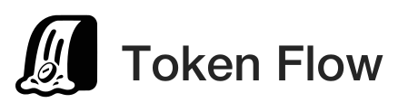
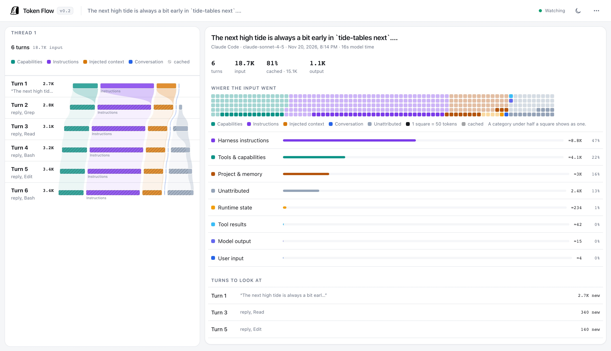
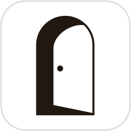

<h1 align="center">
  <picture>
    <source media="(prefers-color-scheme: dark)" srcset=".github/brand/lockup-dark.svg" />
    
  </picture>
</h1>

<p align="center"><b>See where your agent's tokens go.</b></p>

<p align="center">
  <a href="#development-setup">Set up</a> ·
  <a href="#capture-an-agent">Capture an agent</a> ·
  <a href="#architecture">Architecture</a> ·
  <a href="SECURITY.md">Privacy</a> ·
  <a href="README.zh-CN.md">中文</a>
</p>



Token Flow is a local-first viewer for AI-agent conversations. It watches or
proxies supported coding agents, stores their model requests locally, and turns
raw traces into understandable conversations, turns, token composition, cache
flow, and structured request evidence.

> This project is evolving quickly and will remain free and open source forever. If you’ve downloaded it or are using it, please **Star** the repository and [**Follow @SonghaiFan**](https://github.com/SonghaiFan) to keep up with my projects. Your Star is my biggest source of support and motivation to keep building.

## What Token Flow does

- Watches Codex CLI, Codex App, Claude Code, Gemini CLI, and other supported
  agent clients through the local capture backend.
- Groups captured requests into conversations, queries, and turns.
- Shows token composition and how categories change across turns.
- Keeps structured, tree, and raw evidence linked to the same selected block.
- Stores traces on the local machine and redacts common authorization headers
  before recording.

## Development setup

Token Flow requires Python 3.11+, `uv`, and Node.js 22+.

```bash
git clone https://github.com/SonghaiFan/token-flow.git
cd token-flow
uv sync --extra dev

cd ui
npm ci
npm run build
npm run sync
cd ..
```

Open the local dashboard (starts the shared service when needed, then returns
to the shell):

```bash
uv run token-flow
```

The default dashboard is `http://127.0.0.1:19527/`.

## Capture an agent

Flags after `--` are passed to the selected client.

```bash
# Codex CLI
uv run token-flow capture codex --project . -- --full-auto

# Codex App
uv run token-flow capture codexapp --no-open

# Claude Code
uv run token-flow capture claude --project .

# Gemini CLI
uv run token-flow capture gemini --project . -- -p "hello"
```

To stop the shared dashboard:

```bash
uv run token-flow stop
```

Use `uv run token-flow status` to show the dashboard URL and active database.
The older `--tap-*` capture syntax remains available for compatibility.

## UI development

The Vite + React application in `ui/` is the static UI source served by the
Python dashboard.

```bash
cd ui
npm run dev
```

For the Python server to serve the latest production UI:

```bash
cd ui
npm run lint
npm run build
npm run sync
```

Vite output is synced to `token_tap/static_ui/`; do not edit it directly.

## Architecture

```text
agent client
    ↓ local proxy or transcript watcher
Python capture backend (`token_tap/`, compatibility namespace)
    ↓ SQLite + local HTTP / SSE API
Compiled static UI, served by the Python process
```

The Python package name is temporarily retained because it is part of the
working capture engine and local-data compatibility. It is not the product
identity, and the separate `../claude-tap` checkout is reference material only.
The target runtime uses one Python process for capture, storage, analysis, API,
SSE, and static UI serving; Node.js is needed to build the UI, not to serve it.
See [the static UI migration architecture boundary](.agents/docs/architecture/static-ui-migration.md)
for layer ownership and current migration gaps. The observed route, payload,
and event behavior is recorded in the
[local HTTP and SSE API contract](.agents/docs/architecture/http-api-contract.md).

## Privacy

Traces can contain prompts, tool schemas, tool results, file paths, and other
private context. Keep trace databases and exports local unless they have been
reviewed and redacted. See [SECURITY.md](SECURITY.md).

## License

MIT. Token Flow retains the original license notices for inherited code.

<br />

<p align="center">
  <a href="https://leftopen.songhai.site"></a>&nbsp;
  <a href="https://github.com/SonghaiFan/token-flow"></a>&nbsp;
  <a href="https://songhaifan.github.io/roc-ui/"></a>
</p>

<p align="center"><sub>Token Flow is part of the Franklin series.</sub></p>

<p align="right">
  <picture>
    <source media="(prefers-color-scheme: dark)" srcset=".github/brand/frank-signature-dark.svg" />
    
  </picture>
</p>
