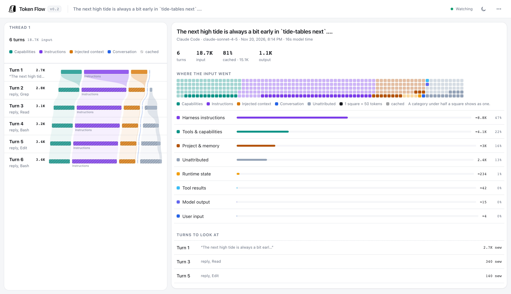

<h1 align="center">
  <picture>
    <source media="(prefers-color-scheme: dark)" srcset=".github/brand/lockup-dark.svg" />
    
  </picture>
</h1>

<p align="center"><b>看清 agent 的 token 去了哪里。</b></p>

<p align="center">
  <a href="#开发环境">开发环境</a> ·
  <a href="#capture-一个-agent">Capture Agent</a> ·
  <a href="#架构">架构</a> ·
  <a href="SECURITY.md">隐私</a> ·
  <a href="README.md">English</a>
</p>



Token Flow 是一个本地优先的 AI Agent 对话查看器。它监听或代理支持的编程 Agent，把模型请求保存在本机，再把原始 trace 整理成容易理解的 conversation、turn、token 构成、cache flow 和结构化的 request evidence。

> 这个项目正在快速迭代，并将永久免费开源。如果你已经下载或正在使用，欢迎 **Star** 收藏项目，并 [**Follow @SonghaiFan**](https://github.com/SonghaiFan) 关注后续项目动态。你的 Star 是对我最大的支持，也是我持续开发的最大动力。

## Token Flow 做什么

- 通过本地 capture backend 监听 Codex CLI、Codex App、Claude Code、Gemini CLI 和其他支持的 Agent 客户端。
- 把捕获的请求整理成 conversation、query 和 turn。
- 展示 token 构成，以及各个 category 在多轮之间如何变化。
- 让 structured、tree 和 raw evidence 指向同一个选中的块。
- Trace 保存在本机；写入前会移除常见的 authorization header。

## 开发环境

需要 Python 3.11+、`uv` 和 Node.js 22+。

```bash
git clone https://github.com/SonghaiFan/token-flow.git
cd token-flow
uv sync --extra dev

cd ui
npm ci
npm run build
npm run sync
cd ..
```

打开本地 dashboard（需要时会启动共享服务，然后回到 shell）：

```bash
uv run token-flow
```

默认地址是 `http://127.0.0.1:19527/`。

## Capture 一个 Agent

`--` 后面的参数会传给所选的客户端。

```bash
# Codex CLI
uv run token-flow capture codex --project . -- --full-auto

# Codex App
uv run token-flow capture codexapp --no-open

# Claude Code
uv run token-flow capture claude --project .

# Gemini CLI
uv run token-flow capture gemini --project . -- -p "hello"
```

停止共享 dashboard：

```bash
uv run token-flow stop
```

`uv run token-flow status` 显示 dashboard 地址和当前使用的数据库。旧的 `--tap-*` capture 写法仍然可用，以保持兼容。

## UI 开发

`ui/` 里的 Vite + React 应用是 Python dashboard 提供的静态 UI 的源码。

```bash
cd ui
npm run dev
```

让 Python server 使用最新的 production UI：

```bash
cd ui
npm run lint
npm run build
npm run sync
```

Vite 的构建结果会同步到 `token_tap/static_ui/`，不要直接修改那里。

## 架构

```text
Agent 客户端
    ↓ 本地 proxy 或 transcript watcher
Python capture backend（`token_tap/`，兼容 namespace）
    ↓ SQLite + 本地 HTTP / SSE API
编译好的静态 UI，由 Python 进程提供
```

Python package 名暂时保留，因为它是现有 capture engine 的一部分，也关系到本地数据的兼容。它不是产品身份；旁边的 `../claude-tap` checkout 只是参考资料。目标运行方式是一个 Python 进程负责 capture、存储、分析、API、SSE 和静态 UI；Node.js 只用于构建 UI，不用于提供 UI。各层的职责和当前的迁移缺口见[静态 UI 迁移的架构边界](.agents/docs/architecture/static-ui-migration.md)。实际观察到的路由、payload 和事件行为记录在[本地 HTTP 与 SSE API 约定](.agents/docs/architecture/http-api-contract.md)中。

## 隐私

Trace 可能包含 prompt、tool schema、tool result、文件路径和其他私密上下文。数据库和导出文件在检查、脱敏之前请只留在本机。详见 [SECURITY.md](SECURITY.md)。

## 许可

MIT。Token Flow 保留了继承代码原有的许可声明。

<br />

<p align="center">
  <a href="https://leftopen.songhai.site"></a>&nbsp;
  <a href="https://github.com/SonghaiFan/token-flow"></a>&nbsp;
  <a href="https://songhaifan.github.io/roc-ui/"></a>
</p>

<p align="center"><sub>Token Flow 是 Franklin 系列的一部分。</sub></p>

<p align="right">
  <picture>
    <source media="(prefers-color-scheme: dark)" srcset=".github/brand/frank-signature-dark.svg" />
    
  </picture>
</p>
