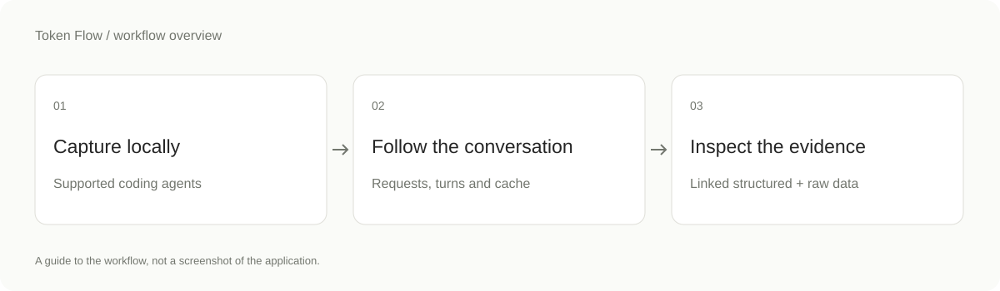

<h1 align="center">
  <picture>
    <source media="(prefers-color-scheme: dark)" srcset=".github/brand/lockup-dark.svg" />
    
  </picture>
</h1>

<p align="center"><b>在本机追踪 AI 编程会话、token 构成与请求证据。</b></p>

<p align="center"><a href="#开发环境">开始</a> · <a href="#capture-一个-agent">捕获会话</a> · <a href="#架构边界">架构</a> · <a href="SECURITY.md">隐私</a> · <a href="README.md">English</a></p>

<picture>
  <source media="(prefers-color-scheme: dark)" srcset=".github/brand/overview-dark.svg" />
  
</picture>

Token Flow 是一个本地优先的 AI Agent conversation 查看器。它通过监听或代理
支持的编程 Agent，把原始请求整理成容易理解的 conversation、turn、token
构成、cache flow 和结构化 request evidence。

> 这个项目正在快速迭代，并将永久免费开源。如果你已经下载或正在使用，欢迎 **Star** 收藏项目，并 [**Follow @SonghaiFan**](https://github.com/SonghaiFan) 关注后续项目动态。你的 Star 是对我最大的支持，也是我持续开发的最大动力。

## Token Flow 做什么

- 通过本地 capture backend 监听 Codex CLI、Codex App、Claude Code、Gemini
  CLI 等 Agent。
- 把请求整理成 conversation、query 和 turn。
- 展示 token 构成，以及不同 category 在多轮之间的变化。
- 让 structured、tree 和 raw evidence 共享同一个选择状态。
- 数据保存在本机；写入前会移除常见的 authorization header。

## 开发环境

需要 Python 3.11+、`uv` 和 Node.js 22+。

```bash
git clone https://github.com/SonghaiFan/token-flow.git
cd token-flow
uv sync --extra dev

cd ui
npm ci
npm run build
npm run sync
cd ..
```

启动本地 dashboard：

```bash
uv run token-flow
```

默认地址是 `http://127.0.0.1:19527/`。

## Capture 一个 Agent

`--` 后面的参数会传给所选客户端。

```bash
# Codex CLI
uv run token-flow --tap-client codex --tap-no-open -- --full-auto

# Codex App
uv run token-flow --tap-client codexapp --tap-no-open

# Claude Code
uv run token-flow --tap-client claude --tap-no-open

# Gemini CLI
uv run token-flow --tap-client gemini --tap-no-open -- -p "hello"
```

停止共享 dashboard：

```bash
uv run token-flow dashboard stop
```

## UI 开发

`ui/` 里的 Vite + React 应用是 UI 唯一的 source of truth。

```bash
cd ui
npm run dev
```

让 Python server 使用最新 production UI：

```bash
cd ui
npm run lint
npm run typecheck:vite
npm run build
npm run sync
```

不要直接修改 `token_tap/static_ui/`；它由 sync 命令生成。

## 架构边界

```text
Agent 客户端
    ↓ 本地 proxy 或 transcript watcher
Python capture backend（`token_tap/`，兼容 namespace）
    ↓ SQLite + 本地 HTTP API
Token Flow 静态 UI（`ui/`）
```

Python package 名暂时保留，是因为当前 capture engine、本地数据和子进程启动
仍依赖它。它不是产品身份；旁边的 `../claude-tap` checkout 也只是源码参考，
不会被 Token Flow import 或运行。

## 隐私

Trace 可能包含 prompt、tool schema、tool result、文件路径和其他私密上下文。
未经检查和脱敏，不要分享数据库或 export。详见 [SECURITY.md](SECURITY.md)。

## License

MIT。继承的代码会保留原作者的 license notice。

<br />

<p align="center">
  <a href="https://github.com/SonghaiFan/leftopen"></a>&nbsp;
  <a href="https://github.com/SonghaiFan/openclaw-visualiser"></a>&nbsp;
  <a href="https://github.com/SonghaiFan/roc-ui"></a>&nbsp;
  <a href="https://github.com/SonghaiFan/token-flow"></a>&nbsp;
  <a href="https://github.com/SonghaiFan/franklin-board"></a>&nbsp;
  &nbsp;
  <a href="https://github.com/SonghaiFan/tasty-text"></a>
</p>

<p align="center"><sub>Token Flow 属于 Franklin 工具系列。</sub></p>

<p align="right">
  <picture>
    <source media="(prefers-color-scheme: dark)" srcset=".github/brand/frank-signature-dark.svg" />
    
  </picture>
</p>
